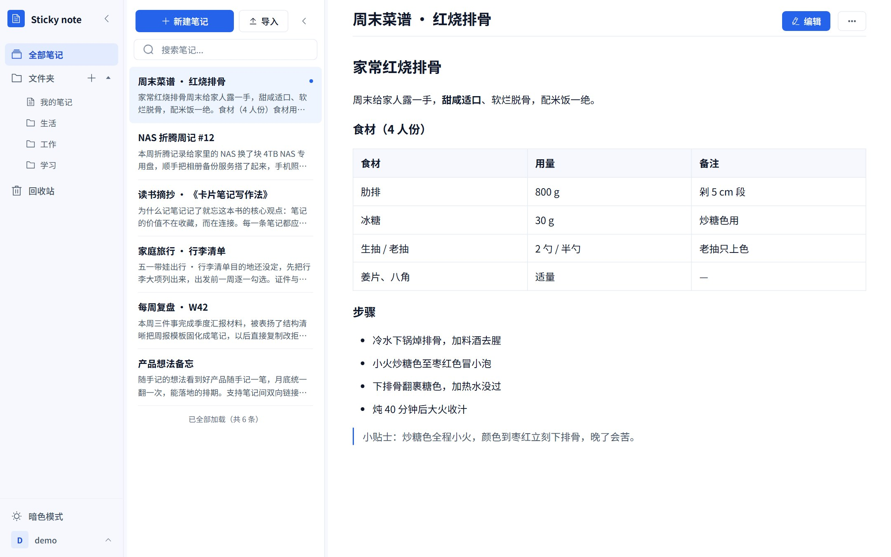
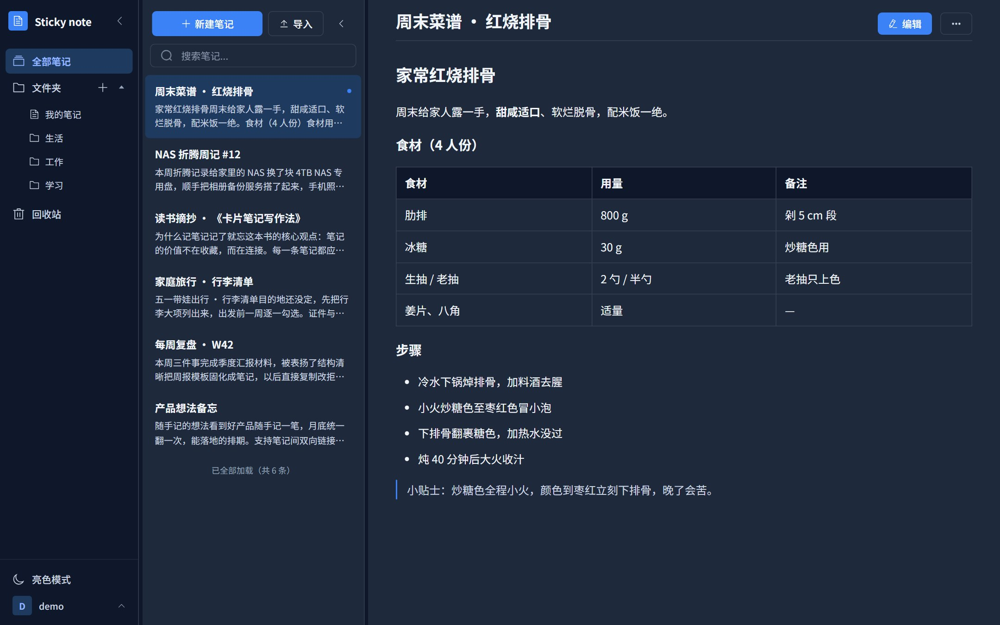
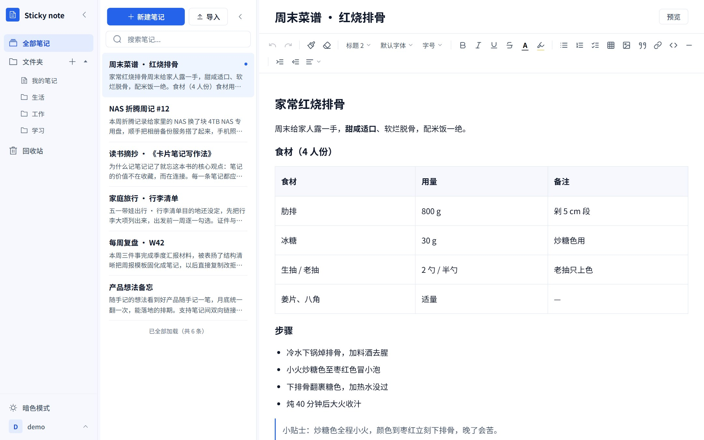
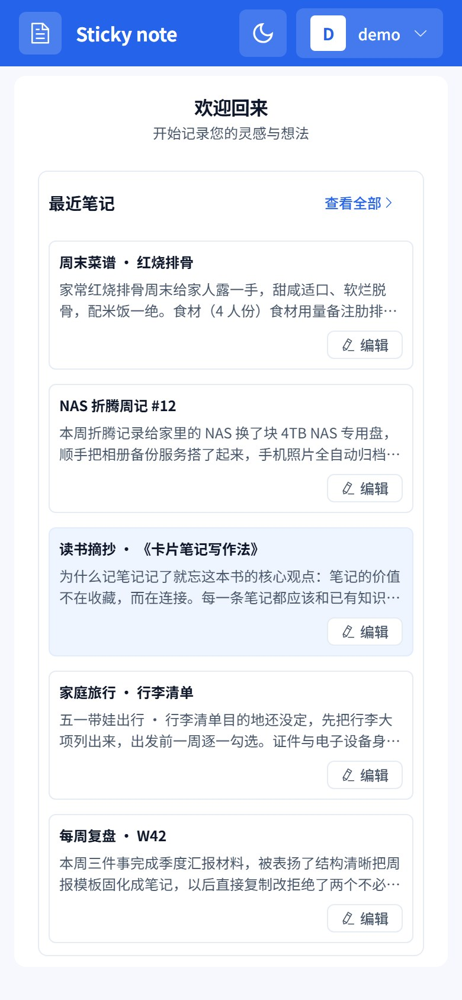
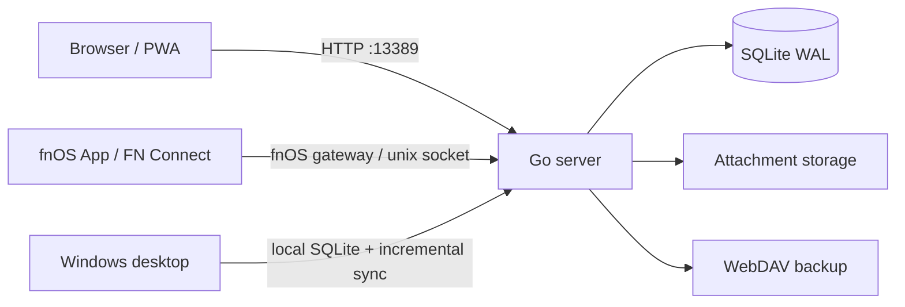

<div align="center">

# Sticky note

**Your notes, kept in your own home.**

A multi-user rich-text note-taking app built for fnOS NAS. Writing, search, encryption, version history, share links and backups all stay on your own disk.

[](https://github.com/yangzhenwei777/fnos-stickynote/releases)
[](https://github.com/yangzhenwei777/fnos-stickynote/actions/workflows/ci.yml)
[](https://hub.docker.com/r/davyang/sticky-note)
[](LICENSE)

English · [简体中文](README.md)

[Features](#features) · [Screenshots](#screenshots) · [Quick Start](#quick-start) · [Security](#security-and-privacy) · [Architecture](#architecture)



</div>

---

## Why Sticky note

- **Own your data**: notes, attachments and accounts live on your NAS. No telemetry, no third-party cloud relay, and backup targets are up to you.
- **One deployment for the whole family**: per-user data isolation, with the first registered user becoming admin.
- **Complete without the bloat**: rich text, full-text search, note encryption, folder access lock, version history, share links, WebDAV backup and a Windows offline client in one binary.
- **Simple to deploy**: install the fpk from the fnOS App Center, run Docker, or start a single binary. No Redis, no message queue, no external database.
- **Built for long-running NAS use**: Go + pure-Go SQLite, `CGO_ENABLED=0`, low idle footprint.

## Features

| Area | Capabilities |
|---|---|
| **Writing** | 25 formatting actions, task lists, tables, images, fonts and font sizes, text/background colors, format painter, alignment and indentation, slash commands, 3-second autosave |
| **Reading** | Reading/edit modes, outline sidebar, pinned header, independently scrolling content and outline, pointer-based wheel routing |
| **Search** | SQLite FTS5 full-text index, LIKE fallback for short queries, `tag:` / `folder:` / `sort:` / `since:` / `until:` syntax |
| **Organization** | Folder CRUD and reordering, folder access lock, trash with restore, attachment lifecycle |
| **Security** | Per-note encryption, TOTP two-factor auth, security-question recovery, three-layer anti-brute-force, CAS conflict protection, XSS sanitization, CSP, global session revocation |
| **History** | Snapshot before each save, 10-minute auto snapshots, read-only preview and one-click restore, count/days/size retention limits |
| **Sharing** | Read-only public links, 1/7/30-day expiry, revocable, hashed tokens, global switch |
| **Backup** | Scheduled WebDAV backup, encrypted `.snbak` archives, integrity checks, master-key export/import |
| **Admin** | Disable/delete users, reset passwords, registration switch, per-user quotas, audit logs |
| **Clients** | Browser, PWA, responsive mobile, fnOS App / FN Connect, Windows offline client |
| **Interop** | Markdown / HTML import, Markdown export, batch ZIP export, long-image PNG export |
| **Experience** | Dark mode, dashboard, pagination, portable desktop build with bundled WebView2 |

## Highlights

### Writing

- 25 formatting actions: headings, bold, italic, underline, strikethrough, quotes, code blocks, ordered/unordered lists, task lists, text color, background color, fonts (8) and sizes (12–32px), format painter, clear formatting, alignment, 0–5 indentation, images, tables (7 operations), links, dividers, undo/redo.
- Slash commands: type `/` at the start of a paragraph to insert blocks, filter by keyword, navigate with arrow keys, confirm with Enter, close with Esc.
- Autosave after 3 seconds of inactivity, or `Ctrl+S`. Reading and editing modes are separate.
- Markdown/HTML import with tables and task lists preserved; single-note Markdown export, batch ZIP export, and one-click long-image PNG export.

### Reading

The reading view uses a pinned header and two independently scrolling columns:

- The title, edit/view toggle and more menu stay fixed while the body scrolls.
- The body and outline scroll independently; the outline remains visible when the body reaches the end.
- The wheel follows the pointer: over the body it scrolls the body, over the outline it scrolls the outline. A short outline or an outline at its boundary does not drag the body.
- The outline scrollbar appears while scrolling and hides after 3 seconds, with a stable gutter to prevent text shifting.
- The outline is built from h1–h3, appears with at least 2 headings, and is hidden on narrow screens and mobile.

### Organization

- Folders with create, rename, delete and reorder; notes can be moved or copied between folders.
- Folder access lock: password-gated hiding from note lists, search, trash, folder counts and exports; unlock lasts for the current session and re-locks on logout or session expiry. This is an access lock, not a second layer of content encryption.
- Trash with restore; permanent deletion cascades to attachments and version history.
- Attachments are validated by magic number, renamed with UUIDs, and managed through a staged → attached → orphan → delete_pending lifecycle with a 24-hour recovery window.

### Security

- **Per-note encryption**: AES-256-GCM with PBKDF2 (600,000 iterations) and bcrypt; each note has its own salt/nonce. Ciphertext is stored; the server never stores plaintext or your note password.
- **TOTP two-factor auth** with recovery codes, plus self-service password recovery via security questions.
- **Anti-brute-force**: IP, username and account layers, persisted in memory and SQLite.
- **CAS optimistic locking**: stale saves return 409 instead of silently overwriting another device's changes.
- **Defense in depth**: bluemonday + DOMPurify sanitization, CSP, external images stripped, dual JWT with `token_version` global revocation.
- **Backup security**: encrypted `.snbak` archives, per-file hashes, integrity verification before restore, encrypted WebDAV credentials, exportable master key.

> Encrypted-note passwords cannot be recovered or reset by an admin. The folder access lock is a visibility lock, not content encryption; a forgotten folder password requires server-side intervention.

### History and sharing

- A snapshot of the previous state is stored in the same transaction before each save; changed notes get automatic snapshots every 10 minutes with hash deduplication.
- History supports read-only preview and one-click restore; the current state is snapshotted before restoring, so the restore itself can be undone.
- Default retention: 50 versions per note / 180 days / 2GB total, configurable in System Settings. Setting the per-note count to 0 stops new history while keeping existing history.
- Share links are read-only, valid for 1/7/30 days (default 7), and revocable. Tokens are returned once at creation and stored only as SHA-256 hashes. Public pages use `noindex` / `no-store`.
- Encrypted notes cannot use history or share links.

### Backup and administration

- Scheduled WebDAV backups to any WebDAV provider, with configurable retention.
- Encrypted backup archives with integrity checks; corrupt backups are rejected before restore.
- Admin features: user disable/delete/password reset, registration switch, per-user note/storage/note-size quotas, searchable audit logs.

### Clients

- **Browser / PWA**: responsive desktop and mobile layouts, installable, dark mode.
- **fnOS**: fpk installation, fnOS App / FN Connect / browser access, TCP + unix socket dual listening for gateway forwarding.
- **Windows desktop**: portable Wails client with local SQLite, offline-first reading and writing, incremental sync, a four-way conflict center, DPAPI-encrypted credentials, portable `.snbak` backup, and a bundled WebView2 runtime.
- **Docker**: `davyang/sticky-note` for linux/amd64 and linux/arm64.

## Screenshots

| Desktop · Reading | Desktop · Dark mode |
|---|---|
|  |  |
| **Desktop · Editor** | **Mobile · Note list** |
|  |  |

> Screenshots are from the 2.3.x UI. Features added in 2.4–2.6 (search syntax, slash commands, reading outline, version history, share links and the dual-scroll reading layout) are described above.

## Quick Start

### fnOS (recommended)

1. Download the latest `StickyNote-<date>-<version>.fpk` from [Releases](https://github.com/yangzhenwei777/fnos-stickynote/releases) (x86/amd64).
2. fnOS App Center → Manual install → upload the fpk.
3. Set the port in the wizard (default `13389`); the JWT secret is generated and persisted automatically.
4. Open the app and register the first account; it becomes admin automatically.
5. Enable TOTP in settings and set a separate password for sensitive notes.

### Docker

```bash
docker run -d --name sticky-note \
  -p 13389:13389 \
  -v sticky-note-data:/app/data \
  -e TZ=Asia/Shanghai \
  davyang/sticky-note:latest
```

For production, pin a specific release tag instead of `latest`. Data lives in `/app/data` (SQLite, attachments and JWT secret); back up that directory. The container uses plain TCP mode; the fnOS unix-socket gateway is only used by the fpk deployment.

### Standalone binary

```bash
./sticky-note
# http://localhost:13389
# The first registered user becomes admin.
```

### Windows desktop

1. Download `sticky-note-desktop-<version>-windows-amd64.zip` from [Releases](https://github.com/yangzhenwei777/fnos-stickynote/releases).
2. Extract and run `sticky-note-desktop.exe`.
3. Portable data lives in `sticky-note-data/` next to the exe; the bundled WebView2 runtime is extracted on first launch.
4. Connect to a remote NAS or use the local offline workspace; changes sync incrementally when online.

### Build from source

Requires Go 1.26.10+ and Node.js 22+; the desktop build also needs Wails CLI v2.16.0 and a Windows build environment.

```bash
make build          # current platform
make cross-compile  # Linux amd64/arm64, macOS amd64/arm64
make build-fpk      # fnOS fpk package
```

Build output goes to `release/<version>/`. The Windows portable build uses `desktop/scripts/build-desktop.ps1`.

### Environment variables

| Variable | Default | Description |
|---|---|---|
| `PORT` | `13389` | Service port |
| `DATA_DIR` | `./data` | Data directory; SQLite database and master key derive from it |
| `UPLOAD_DIR` | `$DATA_DIR/upload` | Attachment storage directory |
| `JWT_SECRET` | random | JWT signing secret; generated and persisted to `$DATA_DIR/.jwt_secret` when unset |
| `COOKIE_SECURE` | auto | Force the Cookie Secure flag; defaults to HTTPS detection |

> For production, enable HTTPS through the fnOS reverse proxy and set `COOKIE_SECURE=1`.

## Security and Privacy

| Layer | Measures |
|---|---|
| Transport | HTTPS recommended; `COOKIE_SECURE` follows HTTPS; tokens never placed in URLs |
| Authentication | bcrypt password hashing; dual JWT; TOTP; recovery codes; security-question recovery |
| Sessions | `token_version` global revocation on password change, logout or user disable |
| Content | Per-note AES-256-GCM; ciphertext at rest; server never stores note passwords |
| Input | Server and client XSS sanitization; CSP; external images stripped; tiered request-body limits |
| Access | Per-user isolation; folder access lock; expiring and revocable share links; `noindex` public pages |
| Brute force | IP / username / account rate limits, persisted in memory and SQLite |
| Attachments | Magic-number validation; UUID names; lifecycle state machine; grace-period recovery |
| Backup | Encrypted `.snbak`; per-file hashes; integrity check before restore; encrypted credentials |
| Dependencies | Pinned builds and CI; govulncheck / npm audit baseline diff; SBOM delivery |

The project has completed four rounds of independent third-party security auditing and maintains a vulnerability baseline for known findings. Security-sensitive paths are fail-closed: invalid states, corrupt backups and untrusted attachments are rejected rather than allowed.

## Architecture



| Layer | Technology |
|---|---|
| Backend | Go 1.26.10, Gin 1.10.1, SQLite (modernc.org/sqlite, pure Go, no CGO), single binary |
| Frontend | Vue 3.5, Vite 8.2.1 (rolldown), Element Plus 2.8, Tiptap 3.31, Pinia |
| Desktop | Wails v2.16.0, local SQLite, bundled WebView2 156 |
| Packaging | fnpack 1.2.3, multi-arch Docker (amd64 / arm64) |
| Testing | Go test (race), Vitest, Playwright E2E, smoke / migration / edge scripts, VM regression |

## Quality

Recent full regression (2.6.3):

| Gate | Result |
|---|---|
| Frontend unit tests | Vitest 513 / 513 (61 files) |
| End-to-end | Playwright E2E 142 passed + 1 skipped |
| Smoke / migration / edge | 460 / 460, 25 / 25, 28 / 28 |
| Go tests | server 18 packages + desktop 7 packages green; gofmt / vet clean |
| VM regression | three suites 462 / 28 / 25; UI walkthrough 17 / 17 |
| Desktop release gate | exe version, WebView2 runtime and icon assertions GREEN |
| Dependencies | Go 74 modules / npm 42 direct dependencies; no new dependencies |

CI also runs `go test -race`, coverage gates, zero-warning ESLint, govulncheck / npm audit baseline diff, secret scanning, VERSION/manifest consistency checks, and fpk structure/version assertions.

## Design boundaries

The following are intentionally out of scope:

- Real-time collaborative editing.
- Real-time sync; the desktop client uses incremental sync with user-resolved conflicts.
- Multi-tenant SaaS.
- Encrypted notes do not enter version history and cannot be shared.
- The folder access lock is not content encryption; there is no in-app password reset.
- Desktop two-factor authentication requires a code on every login; trusted-device bypass is not supported.

These are deliberate boundaries to keep personal and family note-taking secure, simple and maintainable.

## Documentation

| Document | Contents |
|---|---|
| [App introduction](docs/app-introduction.md) | Feature overview, deployment and first use |
| [Changelog](CHANGELOG.md) | Per-release changes and fixes |
| [Security policy](SECURITY.md) | Vulnerability reporting and policy |
| [Desktop build](desktop/README.md) | Windows client build notes |
| [Docker image](https://hub.docker.com/r/davyang/sticky-note) | Tags, architectures and pull instructions |

## Contributing

Issues and pull requests are welcome. Before submitting:

1. Search for an existing issue first.
2. Include tests for code changes and make sure `go test ./...`, `npm run test` and `npm run lint` pass.
3. Report security vulnerabilities privately through GitHub Security Advisories, not in a public issue.

## License

MIT. See [LICENSE](LICENSE).

---

<div align="center">

**Sticky note** · Keep your notes at home.

If this project helps you, a star is appreciated.

</div>
