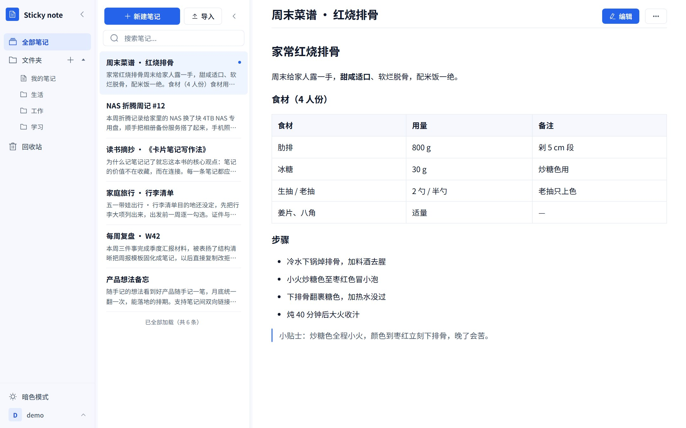
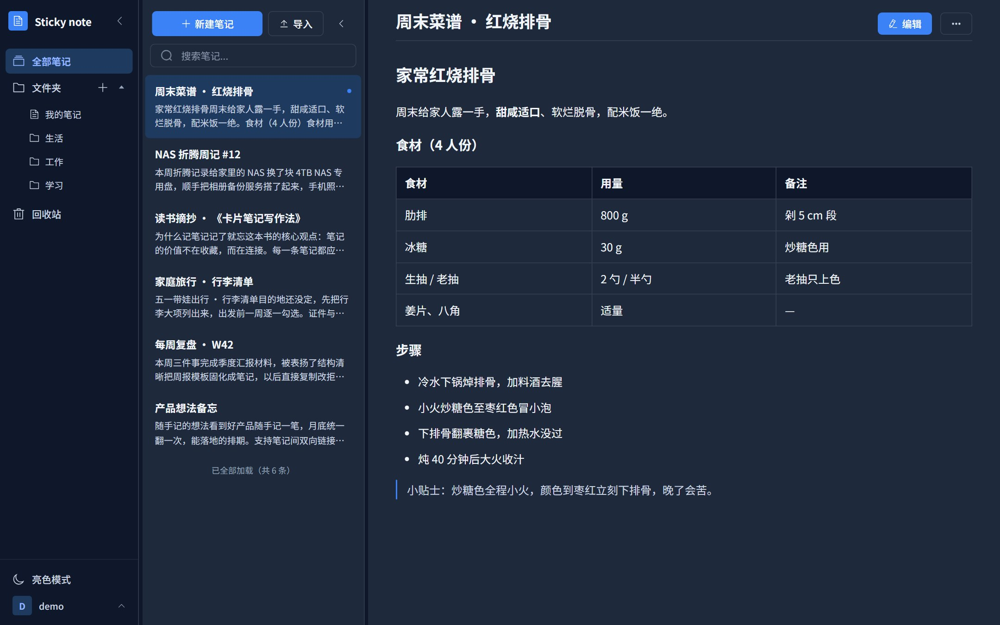
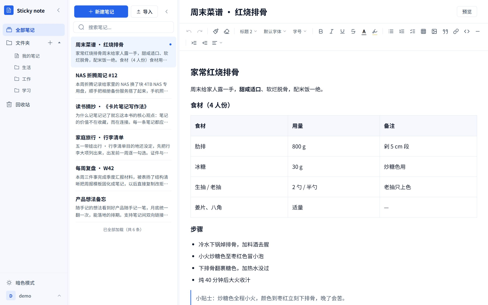
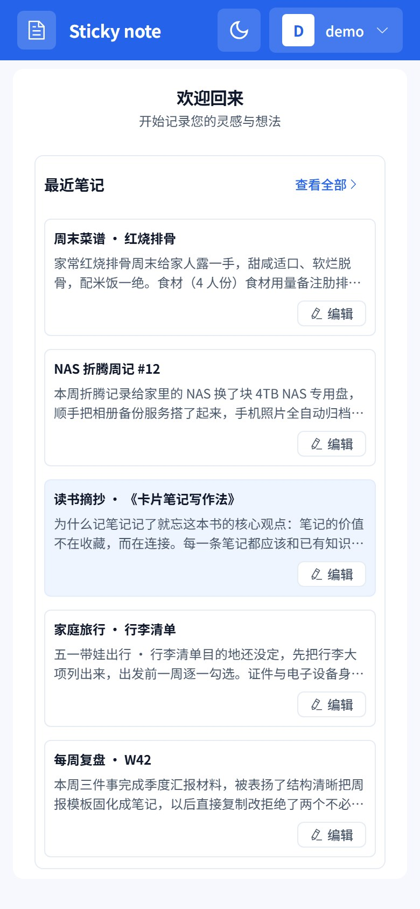
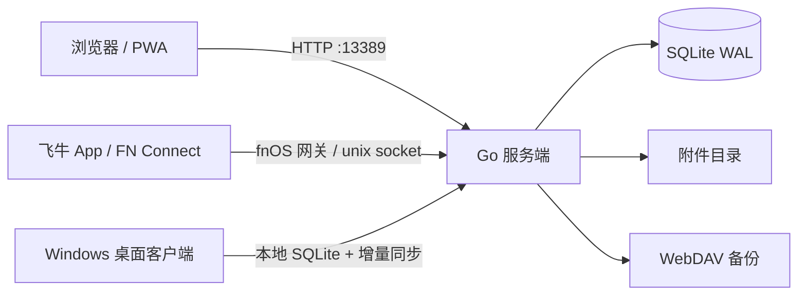

<div align="center">

# Sticky note · 便签

**你的笔记，存在自己家里。**

部署在飞牛 NAS 上的多用户富文本笔记应用。写作、搜索、加密、版本历史、分享链接、自动备份，全部在自己的硬盘上完成。

[](https://github.com/yangzhenwei777/fnos-stickynote/releases)
[](https://github.com/yangzhenwei777/fnos-stickynote/actions/workflows/ci.yml)
[](https://hub.docker.com/r/davyang/sticky-note)
[](LICENSE)
[](#快速开始)

简体中文 · [English](README.en.md)

[功能一览](#功能一览) · [界面](#界面一览) · [快速开始](#快速开始) · [安全与隐私](#安全与隐私) · [技术架构](#技术架构) · [常见问题](#常见问题)



</div>

---

## 为什么选择 Sticky note

- **数据在自己手里**：笔记、附件、账号都存在 NAS 本地硬盘。没有遥测上报，没有第三方云端中转，备份目标也由你指定。
- **一套应用，全家使用**：多用户数据完全隔离，第一个注册的用户自动成为管理员。家庭共享和小团队知识库可以共用一套部署。
- **功能完整，但不臃肿**：富文本、全文搜索、笔记加密、文件夹访问锁、版本历史、分享链接、WebDAV 备份、Windows 离线客户端，该有的能力都在一个单二进制里。
- **部署足够简单**：飞牛应用中心安装 fpk，或用 Docker、单个二进制启动。没有 Redis、没有消息队列、没有外部数据库。
- **长期运行取向**：Go + 纯 Go SQLite，`CGO_ENABLED=0`，常驻资源占用低，适合 NAS 7×24 小时运行。

> 项目已持续迭代 200+ 轮，最新版本见 [Releases](https://github.com/yangzhenwei777/fnos-stickynote/releases)；发布前会完成 fnOS 真机、桌面绿色版与多端回归验证。

## 功能一览

| 模块 | 能力 |
|---|---|
| **写作** | 25 项富文本排版、任务清单、表格、图片、字体字号、文字/背景色、格式刷、对齐缩进、斜杠命令、3 秒自动保存 |
| **阅读** | 阅读/编辑分离、右侧大纲目录、标题栏固定、正文/大纲独立滚动、滚轮按指针分流 |
| **检索** | SQLite FTS5 中文全文索引、短词 LIKE 回退、`tag:` / `folder:` / `sort:` / `since:` / `until:` 搜索语法 |
| **组织** | 文件夹增删改与排序、文件夹访问锁、回收站软删除与恢复、附件生命周期管理 |
| **安全** | 单篇笔记加密、TOTP 两步验证、安全问题找回、三层防爆破、CAS 并发保护、XSS 双端消毒、CSP、全端会话吊销 |
| **版本** | 保存前自动快照、每 10 分钟自动补快照、历史预览与一键恢复、份数/天数/容量三重保留策略 |
| **分享** | 只读公开链接、1/7/30 天有效期、随时撤销、token 哈希落库、全局开关 |
| **备份** | WebDAV 定时备份、`.snbak` 加密归档、完整性校验、主密钥导出/导入 |
| **管理** | 用户禁用/删除/重置密码、注册开关、笔记数/存储/单篇大小配额、操作日志 |
| **多端** | 浏览器、PWA、移动端响应式、飞牛 App / FN Connect、Windows 桌面离线客户端 |
| **互通** | Markdown / HTML 导入、单篇 Markdown 导出、批量 ZIP 导出、笔记导出为长图 PNG |
| **体验** | 暗色模式、仪表盘、列表分页、桌面绿色版、钉版 WebView2 随包 |

## 亮点功能

### 写作：从一句话到长文档

- **25 项排版能力**：标题、加粗、斜体、下划线、删除线、引用、代码块、有序/无序列表、任务清单、文字颜色、背景颜色、字体字号（8 种字体 / 12–32px）、格式刷、清除格式、对齐、0–5 级缩进、图片、表格（行列增删/合并/拆分等 7 项操作）、链接、分割线、撤销/恢复。
- **斜杠命令**：段首输入 `/` 唤起插入菜单，可插入标题、列表、任务清单、引用、代码块、表格、分割线；支持关键词过滤、方向键选择、回车执行、Esc 关闭。
- **自动保存**：停止输入 3 秒自动保存，也可 `Ctrl+S` 立即保存。阅读态与编辑态分离，打开笔记不会误触编辑。
- **导入导出**：Markdown / HTML 导入自动转为富文本，表格与任务清单保留；单篇导出 Markdown，批量导出 ZIP，一键导出为长图 PNG。

### 阅读：把注意力留给内容

阅读态采用独立的固定标题栏与双滚动布局：

- 标题、编辑/查看、更多按钮固定，不随正文滚走；
- 正文与右侧大纲各自独立滚动，正文滚到底大纲仍完整可见；
- 滚轮按指针位置分流：在正文上滚正文，在大纲上滚大纲；大纲不足一屏或到顶/到底时不带动正文；
- 大纲滚动条滚动时显示，停止 3 秒后隐藏，槽位保持稳定不跳动；
- 大纲从 h1–h3 提取，至少 2 个标题时显示，点击跳转到对应段落；窄屏与移动端自动隐藏。

### 整理：文件夹、回收站与附件

- **文件夹**：创建、重命名、删除、拖拽排序；笔记可移动到任意文件夹，也可复制到其他文件夹。
- **文件夹访问锁**：为文件夹设置访问密码后，该文件夹内的笔记从全部笔记、搜索、回收站、文件夹计数与导出中隐藏；输入密码后仅在本次会话内可见，退出账号或会话失效即回锁。
- **回收站**：删除进入回收站，可还原或永久删除；永久删除会级联清理附件与版本历史。
- **附件管理**：上传文件经过魔数校验，伪装成图片的脚本文件会被拒绝；附件按 staged → attached → orphan → delete_pending 状态机管理，删除笔记后保留 24 小时恢复窗口。

### 安全：默认更保守

- **单篇笔记加密**：AES-256-GCM 认证加密，密钥经 PBKDF2 600,000 次迭代派生，每篇笔记独立 salt/nonce；密文落库，服务端不保存明文，也不保存你的笔记口令。
- **两步验证（TOTP）**：标准动态码 + 恢复码；开启后登录需要第二因子。
- **安全问题找回**：预设安全问题即可自助找回密码，不必等待管理员。
- **登录防护**：按 IP、用户名、账号三层限制尝试频率，超限自动锁定；注册、登录、找回密码统一话术与固定延时，降低账号枚举风险。
- **并发保护**：CAS 乐观锁。两台设备同时编辑同一篇笔记，旧版本保存返回 409「已在其他设备修改」，不会静默覆盖。
- **内容防线**：服务端 bluemonday 白名单 + 前端 DOMPurify 双端消毒；CSP 收紧；外链图片一律剥除。
- **会话管控**：JWT 双 token（access 2h / refresh 7–30 天）；修改密码、登出或禁用账号会递增 `token_version`，所有设备立即失效。

> 安全边界：加密笔记的密码无法找回，也无法被管理员重置；文件夹访问锁是可见性访问锁，不对正文做二次加密，忘记密码需要管理员在服务端处置。请在开启前妥善保管口令。

### 历史与分享：给内容多一层保险

- **版本历史**：每次保存前在同一事务内留存上一状态；后台每 10 分钟为有变更的笔记补自动快照，内容哈希去重。历史列表支持只读预览与一键恢复，恢复前会先快照当前内容，恢复动作本身也可再撤销。
- **保留策略**：默认每篇 50 份 / 180 天 / 全库 2GB，可在【系统配置 → 全部配置】调整；份数设为 0 可停止生成新历史，已有历史保留。
- **分享链接**：为笔记生成只读公开链接，有效期 1 / 7 / 30 天（默认 7 天），可随时撤销。token 为 32 字节随机值，仅创建时返回一次，数据库只存 SHA-256 哈希；公开页带 `noindex` / `no-store`，无需登录，只展示标题、正文、标签与更新时间。
- **边界**：加密笔记不支持版本历史与分享链接（入口置灰或隐藏）；分享链接支持全局开关，关闭后创建返回 403、公开访问返回 404。

### 备份与管理：多一条退路

- **WebDAV 自动备份**：连接任意 WebDAV 网盘，按计划定时备份，保留份数可配置。
- **备份包加密**：备份归档全程 AES 加密，逐文件哈希 + 完整性校验；WebDAV 凭据加密存储，界面永不回显；主密钥可导出另存。
- **可信恢复**：恢复前先校验远端备份完整性，损坏的直接拒绝，不会拿坏数据覆盖好数据。
- **管理员能力**：用户禁用、删除、重置密码；注册开关；按用户限制笔记数量、存储空间、单篇大小；登录与关键操作日志可检索。

### 多端：在哪里都能写

- **浏览器 / PWA**：桌面与移动端响应式布局；可添加到桌面或主屏，独立窗口运行；支持暗色模式。
- **飞牛 fnOS**：应用中心安装 fpk；支持飞牛 App、FN Connect 与浏览器统一入口；服务端同时监听 TCP 与 unix socket，便于网关转发。
- **Windows 桌面客户端**：Wails 构建的绿色版，解压即用；本地 SQLite 本地优先读写，联网后增量同步；冲突中心提供「以本机为准重投 / 接受远端覆盖 / 放弃本机这笔 / 以本机内容重建到服务器」四种处置；登录凭据经 Windows DPAPI 加密并与设备绑定；支持便携备份 `.snbak`；WebView2 运行时随包分发，不依赖系统升级。
- **Docker**：`davyang/sticky-note` 提供 linux/amd64 与 linux/arm64 镜像，适合群晖、威联通、Unraid 等 NAS 或普通 Linux 主机。

## 界面一览

| 桌面端 · 阅读 | 桌面端 · 暗色模式 |
|---|---|
|  |  |
| **桌面端 · 编辑器** | **移动端 · 笔记列表** |
|  |  |

> 截图为 2.3.x 时代界面；2.4–2.6 新增的搜索语法、斜杠命令、阅读大纲、版本历史、分享链接与阅读态双滚动布局，以实际版本为准。

## 快速开始

### 方式一：飞牛 fnOS（推荐）

1. 打开 [Releases](https://github.com/yangzhenwei777/fnos-stickynote/releases) 下载最新 `StickyNote-<日期>-<版本>.fpk`（当前为 x86/amd64）。
2. 飞牛应用中心 → 手动安装 → 上传 fpk。
3. 按向导配置端口（默认 `13389`）；JWT 密钥默认自动生成并持久化。
4. 安装完成后打开应用，注册第一个账号，自动成为管理员。
5. 建议在设置中开启两步验证，并为敏感笔记设置独立密码。

### 方式二：Docker

```bash
docker run -d --name sticky-note \
  -p 13389:13389 \
  -v sticky-note-data:/app/data \
  -e TZ=Asia/Shanghai \
  davyang/sticky-note:latest
```

仓库内也提供 `docker-compose.yaml`，可通过 `STICKY_NOTE_VERSION` 指定版本。

注意事项：

- 生产环境请把 `latest` 替换为具体版本 tag（见 [Releases](https://github.com/yangzhenwei777/fnos-stickynote/releases)），`latest` 仅便于快速体验；
- 数据全部在 `/app/data`（SQLite、附件、JWT 密钥），备份该目录即可；
- 容器内使用纯 TCP 直连模式，fnOS unix socket 网关模式仅适用于 fpk 部署；
- 升级时执行 `docker compose pull && docker compose up -d`，数据卷兼容。

### 方式三：直接运行二进制

```bash
./sticky-note
# 访问 http://localhost:13389
# 第一个注册的用户自动成为管理员
```

### 方式四：Windows 桌面客户端

1. 从 [Releases](https://github.com/yangzhenwei777/fnos-stickynote/releases) 下载 `sticky-note-desktop-<版本>-windows-amd64.zip`。
2. 解压到任意目录，运行 `sticky-note-desktop.exe`。
3. 绿色版数据默认在 exe 同目录的 `sticky-note-data/`；首次启动会自解压随包的 WebView2 运行时。
4. 登录页可连接远端 NAS，也可在离线模式下使用本地工作区；联网后自动增量同步。

### 从源码构建

前置：Go 1.26.10+、Node.js 22+；桌面端另需 Wails CLI v2.16.0 与 Windows 构建环境。

```bash
make build          # 当前平台
make cross-compile  # Linux amd64/arm64、macOS amd64/arm64
make build-fpk      # fnOS fpk 包
```

构建产物输出到 `release/<version>/`。桌面绿色版使用 `desktop/scripts/build-desktop.ps1` 构建。

### 环境变量

| 变量 | 默认值 | 说明 |
|---|---|---|
| `PORT` | `13389` | 服务端口 |
| `DATA_DIR` | `./data` | 数据目录；SQLite 数据库与主密钥由此派生 |
| `UPLOAD_DIR` | `$DATA_DIR/upload` | 附件存储目录 |
| `JWT_SECRET` | 随机生成 | JWT 签名密钥；未设置时自动生成并持久化到 `$DATA_DIR/.jwt_secret` |
| `COOKIE_SECURE` | 自动 | 强制 Cookie Secure 标志；默认跟随 HTTPS |

> 生产环境建议通过 fnOS 反向代理启用 HTTPS，并设置 `COOKIE_SECURE=1`。

## 安全与隐私

| 层面 | 措施 |
|---|---|
| 传输 | 建议全站 HTTPS；`COOKIE_SECURE` 跟随 HTTPS；登录 token 不落 URL |
| 认证 | bcrypt 密码哈希；JWT 双 token；TOTP 两步验证；恢复码；安全问题找回 |
| 会话 | `token_version` 全局吊销；修改密码 / 登出 / 禁用账号立即全端失效 |
| 内容 | 笔记级 AES-256-GCM；密文入库；服务端不保存笔记口令 |
| 输入 | 双端 XSS 白名单消毒；CSP；外链图片剥除；请求体分级上限 |
| 访问 | 多用户数据隔离；文件夹访问锁；分享链接有效期与撤销；公开页 `noindex` |
| 暴力破解 | IP / 用户名 / 账号三层限流，内存 + SQLite 持久化 |
| 附件 | 魔数校验；UUID 重命名；生命周期状态机；删除宽限恢复 |
| 备份 | `.snbak` 全程加密；逐文件哈希；恢复前完整性自检；凭据加密存储 |
| 依赖 | 构建与 CI 钉版；govulncheck / npm audit 基线差分；SBOM 交付 |

项目已完成 4 轮第三方独立安全审计闭环，并对历史审计项建立了漏洞基线台账。安全设计遵循 Fail-Closed：非法状态、损坏备份、不可信附件一律拒绝，而不是放行。

## 技术架构



| 层 | 技术 |
|---|---|
| 后端 | Go 1.26.10、Gin 1.10.1、SQLite（modernc.org/sqlite，纯 Go，无 CGO）、单二进制 |
| 前端 | Vue 3.5、Vite 8.2.1（rolldown）、Element Plus 2.8、Tiptap 3.31、Pinia |
| 桌面 | Wails v2.16.0、本地 SQLite、钉版 WebView2 156 随包 |
| 打包 | fnpack 1.2.3、Docker 多架构（amd64 / arm64） |
| 测试 | Go test（含 race）、Vitest、Playwright E2E、冒烟 / 迁移 / 边界脚本、VM 真机回归 |

### 项目结构

```text
├── server/              # Go 后端：认证、笔记、搜索、加密、备份、同步
├── web/                 # Vue 3 前端：编辑器、列表、阅读态、管理后台
├── desktop/             # Wails Windows 离线客户端
├── fnpack/              # fnOS fpk 模板与生命周期钩子
├── scripts/             # 构建、测试与质量门禁脚本
├── docs/                # 产品、接口、安全与运维文档
├── VERSION              # 版本号唯一事实源
└── Makefile             # 构建入口
```

## 质量保障

2.6.3 交付实测：

| 门禁 | 结果 |
|---|---|
| 前端单元测试 | Vitest 513 / 513（61 个文件） |
| 端到端测试 | Playwright E2E 142 通过 + 1 skip |
| 冒烟 / 迁移 / 边界 | 460 / 460、25 / 25、28 / 28 |
| Go 单测 | server 18 包 + desktop 7 包全绿；gofmt / vet 0 |
| 真机回归 | 测试飞牛 VM 三套件 462 / 28 / 25；UI 走查 17 / 17 |
| 桌面发布门禁 | 绿色版 exe 版本、WebView2 运行时、图标断言 3 层 GREEN |
| 依赖 | Go 74 个模块 / npm 直接依赖 42 项；零新增依赖 |

持续集成还会执行：`go test -race`、覆盖率门禁、ESLint 零告警、`govulncheck` / `npm audit` 基线差分、`check_secrets` 凭据扫描、VERSION 与 fpk manifest 一致性校验、fpk 结构与版本字面量校验。

## 设计边界

为了让产品保持轻量、可维护，以下能力**明确不做**：

- 不做多人实时协作编辑；
- 不做实时同步（桌面端采用增量同步，冲突交由用户裁决）；
- 不做多租户 SaaS；
- 加密笔记不进入版本历史，也不能生成分享链接；
- 文件夹访问锁不是内容二次加密，忘记密码不提供应用内重置；
- 桌面端两步验证每次登录都需要输入动态码，不提供信任设备免码。

这些不是缺失，而是刻意的产品边界：把个人与家庭多用户笔记做得安全、简单、可长期运行。

## 常见问题

<details>
<summary><b>需要什么硬件和环境？</b></summary>

一台飞牛 fnOS NAS 即可，应用中心安装 fpk 就能用；也支持 Docker、Linux 二进制与 Windows 桌面客户端。默认端口 `13389`，无需公网服务器、无需订阅。
</details>

<details>
<summary><b>数据存在哪里，会被上传吗？</b></summary>

笔记、附件、账号全部存在你的 NAS 本地硬盘。应用没有遥测上报，也没有第三方云同步；只有你主动配置的 WebDAV 备份会把加密归档发送到你指定的网盘。
</details>

<details>
<summary><b>全家多人使用会互相看到吗？</b></summary>

不会。每个用户的数据完全隔离，第一个注册用户自动成为管理员。管理员可以禁用、删除用户或重置密码，但看不到其他用户的加密笔记明文。
</details>

<details>
<summary><b>手机上怎么用？</b></summary>

浏览器直接访问即可获得移动端布局；也可以把 PWA 添加到主屏，或通过飞牛 App、FN Connect 进入。三个入口读写的是同一份数据。
</details>

<details>
<summary><b>忘记笔记加密密码怎么办？</b></summary>

无法找回。笔记加密的设计就是服务端不保存明文和口令，管理员也无法解密。请在开启前把密码记录到可信的密码管理器中，并在加密前确认内容已备份。
</details>

<details>
<summary><b>文件夹加密和笔记加密有什么区别？</b></summary>

笔记加密会对正文做 AES-256-GCM 加密，密文落库；文件夹加密是访问锁，用来把整个文件夹从列表、搜索、回收站和导出中隐藏，不对正文做二次加密。两者可以同时使用。
</details>

<details>
<summary><b>以后不想用了，数据能带走吗？</b></summary>

可以。单篇导出 Markdown，全部笔记批量导出 ZIP，笔记可导出为长图；桌面端还支持便携备份 `.snbak`。备份归档可恢复到新的部署。数据不被格式绑架。
</details>

<details>
<summary><b>桌面客户端支持哪些系统？</b></summary>

当前提供 Windows amd64 绿色版，随包分发钉版 WebView2 运行时，解压即用。macOS / Linux 桌面形态尚未提供，可使用浏览器或 PWA。
</details>

## 文档

| 文档 | 内容 |
|---|---|
| [应用介绍](docs/app-introduction.md) | 功能概览、部署信息与首次使用 |
| [变更日志](CHANGELOG.md) | 逐版变更与修复记录 |
| [安全策略](SECURITY.md) | 漏洞报告渠道与安全策略 |
| [桌面端构建](desktop/README.md) | Windows 离线客户端构建说明 |
| [Docker 镜像](https://hub.docker.com/r/davyang/sticky-note) | 镜像标签、架构与拉取方式 |

## 参与贡献

欢迎提交 Issue 与 Pull Request。提交前请：

1. 先搜索是否已有相同 Issue；
2. 代码改动附带对应测试，并确保 `go test ./...`、`npm run test`、`npm run lint` 通过；
3. 安全漏洞不要公开开 Issue，请通过 GitHub Security Advisories 私下报告。

## License

MIT，详见 [LICENSE](LICENSE)。

---

<div align="center">

**Sticky note** · 把笔记安放在自己的 NAS 上。

如果这个项目对你有帮助，欢迎点一个 Star。

</div>
